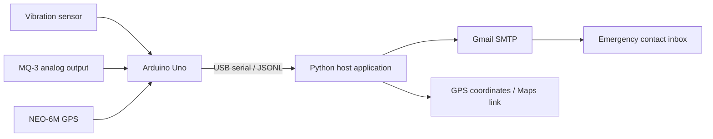

# Vehicle Accident Alert System

**Academic embedded-systems project · Arduino Uno · Vibration detection · MQ-3 sensing · GPS · Email alerts**

**Repository status — documentation foundation.** This repository currently contains project documentation and a portfolio archive. The verified firmware, Python application, dependency manifest, and reproducible test artifacts have not yet been added, so the project described here is not currently runnable from this repository.

This project describes an embedded vehicle-safety prototype that reads vibration, alcohol-sensor, and GPS data using an Arduino Uno, then sends telemetry to a Python host application for event processing and optional emergency email notifications. It is an educational prototype, not a certified accident-detection or emergency-response system.

## Overview

The Vehicle Accident Alert System is an embedded prototype that monitors vibration, alcohol-sensor input, and GPS location, then supports automated emergency email notifications through a host computer.

The Arduino Uno acquires and streams sensor telemetry over USB serial. A connected Python application processes the data, detects configured events, and can send notifications through Gmail SMTP.

This is an educational safety prototype, not a certified accident-detection or emergency-response system.

## Project goals

- Detect vibration or impact-like events using a digital vibration sensor.
- Read the MQ-3 module's analog alcohol-sensor output.
- Obtain and include GPS coordinates using a NEO-6M module.
- Transmit structured telemetry from Arduino to a Python host over serial.
- Support configurable event thresholds and alert cooldowns.
- Send emergency email notifications and GPS information.
- Document the hardware, software, setup, limitations, and safe testing process.

## Reported project scope

The implementation is described as follows:

- Arduino Uno interfaces with a vibration module, MQ-3 analog sensor, and NEO-6M GPS breakout.
- TinyGPSPlus parses GPS NMEA data on the Arduino.
- The Arduino emits newline-delimited JSON telemetry over USB serial.
- Python parses telemetry and detects vibration and MQ-3 threshold events.
- A separate cooldown is applied to alert types.
- Gmail SMTP is used for automated emergency email notifications.
- GPS coordinates are included with alerts when a valid fix is available.
- Dry-run mode allows safe software testing without sending email.

## Hardware

| Component | Role | Intended connection |
|---|---|---|
| Arduino Uno | Sensor acquisition and serial telemetry | USB to host computer |
| Digital vibration module | Vibration/impact trigger input | DO → D2 |
| MQ-3 module | Alcohol-sensitive analog reading | AO → A0 |
| NEO-6M GPS breakout | Latitude and longitude | TX → D4, RX → D3 |
| Computer | Runs Python application and email delivery | USB serial |

### Wiring reference

| Module | Pin | Arduino Uno |
|---|---|---|
| Vibration module | DO | D2 |
| Vibration module | VCC / GND | Suitable supply / GND |
| MQ-3 module | AO | A0 |
| MQ-3 module | VCC / GND | Suitable supply / GND |
| NEO-6M | TX | D4 |
| NEO-6M | RX | D3 |
| NEO-6M | GND | GND |
| NEO-6M | VCC | Breakout-specified supply |

Confirm the pinout and voltage limits of the exact modules before powering the circuit.

## System architecture



## Processing overview

1. The Arduino reads the vibration digital output and MQ-3 analog output.
2. TinyGPSPlus parses location data from the NEO-6M module.
3. The Arduino sends structured telemetry at regular intervals.
4. Python validates the telemetry and checks configured event conditions.
5. Alert cooldowns prevent repeated notifications for the same event type.
6. The latest valid GPS fix can be included in an email notification.

## Proposed serial protocol

The intended format is one newline-delimited JSON object per reading:

```json
{"vibration":1,"alcohol_raw":215,"gps_valid":true,"latitude":12.971600,"longitude":77.594600,"gps_age_ms":1200}
```

The coordinates above are illustrative. The exact firmware and protocol artifacts remain to be added or documented in this repository.

## Repository contents

```text
.
├── README.md
├── CONTRIBUTING.md
├── Vehicle-Accident-Alert-System-Portfolio.zip
└── docs/
    ├── IMPLEMENTATION_STATUS.md
    ├── PROJECT_OVERVIEW.md
    └── PROJECT_PLAN.md
```

The portfolio archive documents the author's original project work. It should be used as supporting evidence, not as a substitute for adding documented source files and reproducible setup instructions.

## Setup and execution

Verified project source, dependencies, firmware, and run instructions will be documented here as they are added to the repository. Until then, this README describes the author's project scope rather than a currently runnable implementation.

Recommended safe setup:

1. Verify the exact hardware modules and wiring.
2. Flash the Arduino firmware when the verified sketch is added.
3. Install the Python dependencies on the host computer.
4. Configure serial and notification settings.
5. Keep email delivery in dry-run mode during initial testing.
6. Enable SMTP only after controlled testing with a test recipient.

## Limitations and safety

- A vibration module detects vibration or a logic transition; it does not confirm a real collision or measure impact severity.
- MQ-3 raw ADC readings are affected by warm-up, temperature, humidity, airflow, sensor age, and calibration.
- An MQ-3 count is not a measured blood/breath alcohol level or a legal impairment determination.
- GPS fixes may be unavailable or inaccurate, especially indoors or under poor sky visibility.
- Email is a best-effort notification channel and is not a guaranteed emergency response method.
- The system depends on Arduino, USB serial, a powered host computer, and internet connectivity.
- This project is not a replacement for airbags, certified eCall systems, alcohol interlocks, emergency services, or other approved safety equipment.
- Test only in a controlled bench environment. Never stage a road collision or drive while impaired.

## Roadmap and status

See [docs/PROJECT_PLAN.md](docs/PROJECT_PLAN.md) and [docs/IMPLEMENTATION_STATUS.md](docs/IMPLEMENTATION_STATUS.md) for implementation planning and verification status.

## Contributing

Issues and pull requests are welcome. Contributions should remain focused, documented, and reproducible. Read [CONTRIBUTING.md](CONTRIBUTING.md) before contributing.

## License

No license has been selected for original repository work. Review the portfolio archive and third-party components before redistribution.

## Author

**Vivekanand Naik** · [GitHub](https://github.com/vivekanandnaikk) · [LinkedIn](https://www.linkedin.com/in/vivekanand-naik)
