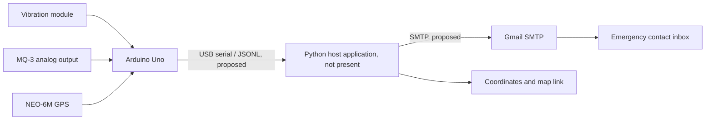

# Vehicle Accident Alert System

**Educational automotive-safety prototype · Arduino Uno · vibration, MQ-3, GPS, and host-side email concept**

> **Repository status — documentation foundation.** This repository currently contains a short README and a portfolio ZIP. The ZIP has not been inspected, and no Arduino sketch, Python application, circuit records, dependency manifest, or reproducible test results have been verified. This README records the project details supplied by the author; it does not claim that the described system is implemented or validated here.

## Overview

The project concept is an embedded automotive-safety prototype that monitors a vibration sensor and an MQ-3 alcohol-sensor module, obtains location from a NEO-6M GPS module, and notifies an emergency contact by email. The described hardware is an Arduino Uno. A separate computer would run Python, read telemetry from the Arduino over USB serial, and send email through Gmail SMTP.

**The Arduino Uno does not run Python.** In the described architecture, Arduino firmware would acquire sensor data, while Python would run on a connected host computer. The host and an internet connection would be needed for email delivery. These are design details supplied by the author, not features verified in this repository.

This is an educational project concept, not a certified automotive safety system or emergency-response service.

## Project goals

- Describe a sensor interface for vibration, MQ-3 analog readings, and GPS coordinates.
- Define a serial telemetry format between an Arduino and a host computer.
- Outline host-side event handling and optional email notifications.
- Document the intended wiring, assumptions, limitations, and verification work needed before implementation claims can be made.

## Project scope described by the author

The supplied project details describe the following intended design:

- Arduino Uno reads a digital vibration-module output and the MQ-3 module's analog output.
- A NEO-6M GPS breakout supplies location data.
- TinyGPSPlus is the intended Arduino library for parsing GPS data.
- The Arduino-to-host link uses USB serial and newline-delimited JSON.
- A Python host application would parse telemetry, detect vibration and configurable MQ-3 raw-count events, and apply alert cooldowns.
- The host could send informational email notifications through Gmail SMTP and include the latest valid GPS coordinates.
- A dry-run mode is recommended for software testing before any email delivery is enabled.

The original source, exact sensor models, wiring, thresholds, and test evidence have not been independently verified. No performance, accuracy, crash-detection, or alcohol-measurement claims are made.

## Proposed architecture

The diagram represents the described design, not verified or runnable components in this repository.



Intended data flow:

1. Arduino samples the vibration digital output and MQ-3 analog output.
2. A GPS library parses NMEA data from the GPS module.
3. Firmware emits one structured telemetry record per line over USB serial.
4. A host application validates records and applies event and cooldown logic.
5. If configured and online, the host may attempt to send an informational email.

## Hardware described in the project notes

| Component | Intended role | Reference connection from supplied notes |
|---|---|---|
| Arduino Uno | Sensor interface and USB serial telemetry | USB to host computer |
| Digital vibration module | Vibration trigger input | DO → D2 |
| MQ-3 module | Raw analog sensor reading | AO → A0 |
| NEO-6M GPS breakout | GPS data | TX → D4; RX → D3 |
| Computer | Proposed Python host and email client | USB serial |

These are unverified reference connections, not a build-ready circuit. The exact vibration board and GPS breakout are unknown. Verify the pinout, supply voltage, logic-level tolerance, and current requirements against the documentation for the specific modules before wiring or powering anything.

### Electrical and interpretation cautions

- Connect grounds only as appropriate for the verified circuit and module specifications.
- Do not assume a NEO-6M breakout accepts 5 V power or 5 V UART logic; breakout designs vary and level shifting may be required.
- MQ-3 modules include a heater and can draw significant current. Follow the specific module's power and warm-up requirements.
- Vibration output polarity varies. Determine the active level for the actual module.
- An MQ-3 ADC count is not a calibrated alcohol concentration, breath-alcohol result, or legal impairment measurement.

## Proposed software design

The supplied design notes describe a possible Python host package with configuration, serial-protocol parsing, event detection, notification delivery, and unit tests. Those source files and tests are not currently verified in this repository.

| Proposed part | Intended responsibility | Current repository status |
|---|---|---|
| Arduino firmware | Read sensors, parse GPS, emit JSONL | Not present/verified |
| Python serial application | Read and validate telemetry | Not present/verified |
| Event logic | Vibration edge and configurable MQ-3 raw-count threshold with cooldown | Not present/verified |
| Email notifier | Dry-run output or Gmail SMTP message | Not present/verified |
| Tests and CI | Parser and event-logic checks | Not present/verified |

## Repository contents

```text
.
├── README.md
├── Vehicle-Accident-Alert-System-Portfolio.zip  # supplied archive; contents not inspected
├── CONTRIBUTING.md
└── docs/
    ├── IMPLEMENTATION_STATUS.md
    └── PROJECT_PLAN.md
```

The archive is retained as supplied. Until its contents are inspected and provenance, source, and licenses are understood, this repository does not treat it as verified implementation evidence.

## Setup and execution

There is currently no verified firmware, Python application, dependency manifest, or test suite in the repository, so no project-specific installation, flash, or run command is available yet. The architecture and technology names in the supplied project details are not sufficient to establish a reproducible build.

When the actual source is available, document tested Arduino IDE/library versions, Python version and dependencies, serial settings, configuration, supported operating systems, and safe dry-run instructions. Do not put email credentials in source control; use a secret store or an ignored local configuration file.

## Serial protocol described in the project notes

The supplied example proposes one JSON object per line with vibration state, an MQ-3 raw ADC value, and GPS fix information:

```json
{"vibration":1,"alcohol_raw":215,"gps_valid":true,"latitude":12.971600,"longitude":77.594600,"gps_age_ms":1200}
```

The coordinates are illustrative. This is a proposed example, not a protocol validated against firmware in this repository. A protocol specification, validation rules, stale-fix handling, and malformed-record behavior remain to be established.

## Validation and evidence needed

Before describing the system as implemented or tested, add the actual source files and document:

- Exact board and module model numbers, wiring, pin polarity, voltage levels, current requirements, and power design.
- Arduino build environment, TinyGPSPlus version, Python version, dependency versions, and serial-port configuration.
- The meaning of each telemetry field and the behavior for missing, invalid, or stale GPS fixes.
- How any sensor thresholds were selected and measured; an MQ-3 raw count must not be presented as an alcohol concentration.
- Automated tests for parsing and event logic, plus hardware bench-test procedures and observed results.
- Email configuration and safe verification procedure using a controlled test recipient and dry-run mode.
- Any performance or reliability claims with reproducible methods and evidence.

## Limitations and safety

- A vibration switch detects vibration or a logic transition; it does not confirm a crash or measure collision severity. Road bumps, engine vibration, handling, and mounting can trigger it.
- MQ-3 raw output is affected by warm-up, temperature, humidity, airflow, sensor age, module circuitry, and calibration. It cannot determine legal impairment or fitness to drive.
- GPS can be unavailable, inaccurate, or stale, especially indoors or where the sky view is obstructed.
- In the described design, email depends on a separate host computer, power, USB serial, internet connectivity, and SMTP availability. Delivery is not guaranteed or necessarily timely.
- No automotive-grade power design, safety certification, validated crash logic, or fail-safe behavior is established by the available repository contents.
- Do not connect this concept to vehicle control systems or use it in place of airbags, eCall, certified alcohol interlocks, emergency services, or other approved safety equipment.
- Test only in a controlled bench environment. Never stage a road collision or drive while impaired. If an actual emergency occurs, contact local emergency services directly.

## Roadmap

See [docs/PROJECT_PLAN.md](docs/PROJECT_PLAN.md) for the documentation and implementation roadmap and [docs/IMPLEMENTATION_STATUS.md](docs/IMPLEMENTATION_STATUS.md) for repository evidence and verification status. Roadmap items are not implemented features.

## Author

The supplied project notes credit **Vicky Naik**, Electronics and Communication Engineering Graduate. The repository is owned by [vivekanandnaikk](https://github.com/vivekanandnaikk). Confirm the preferred public author name and attribution before release.
